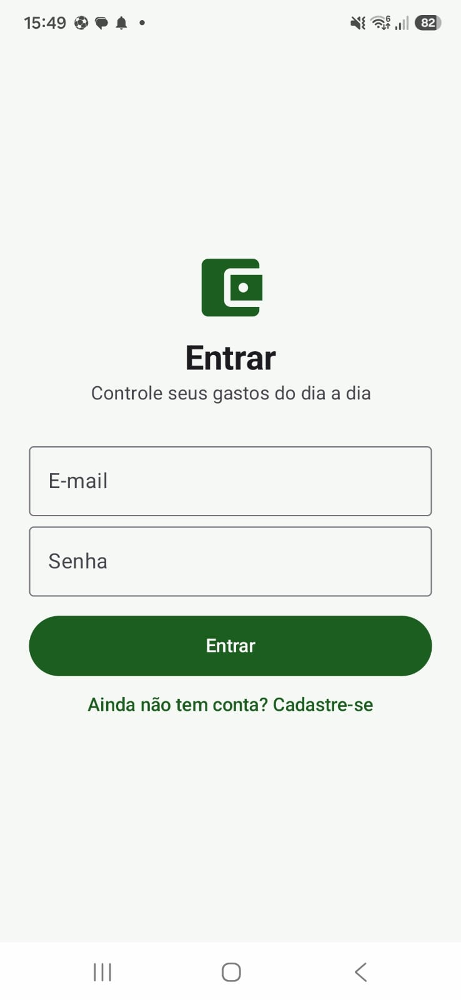
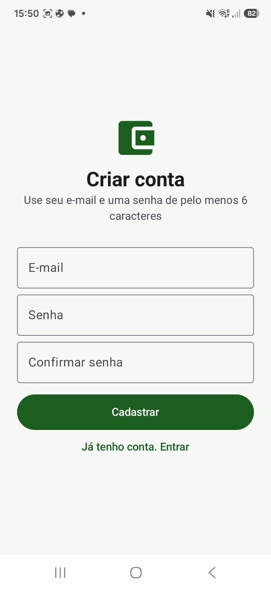
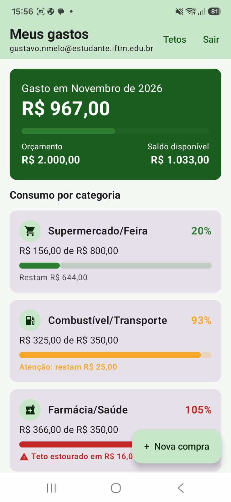
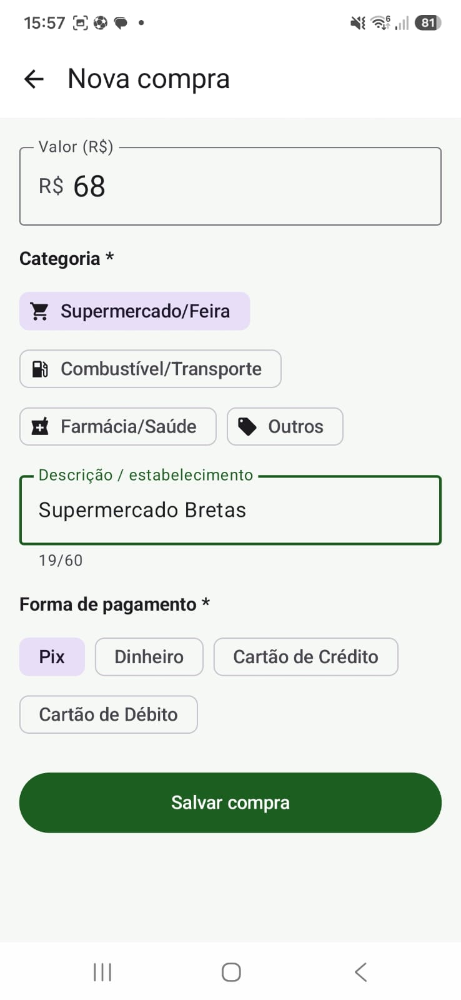
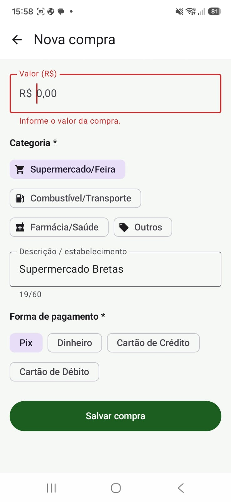
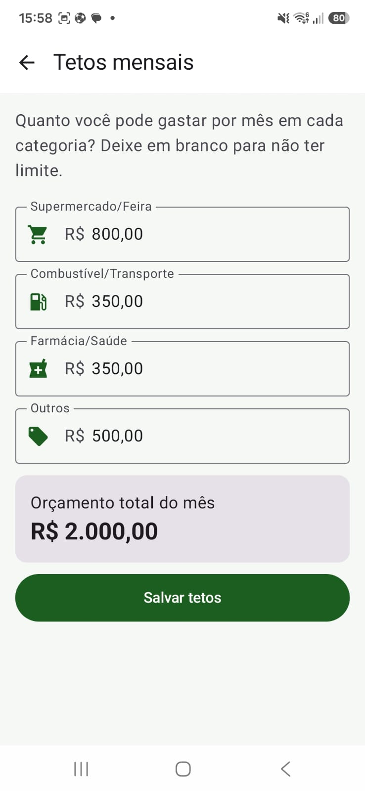
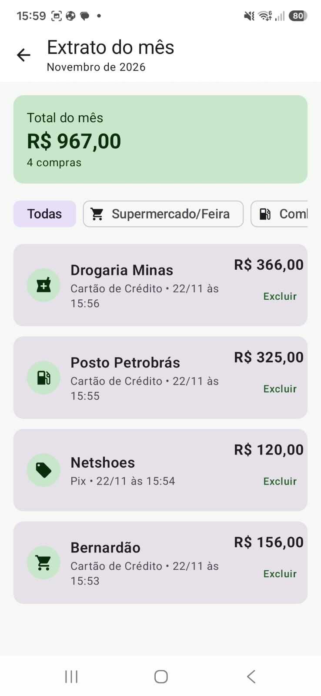
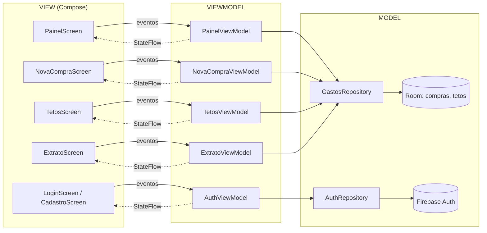
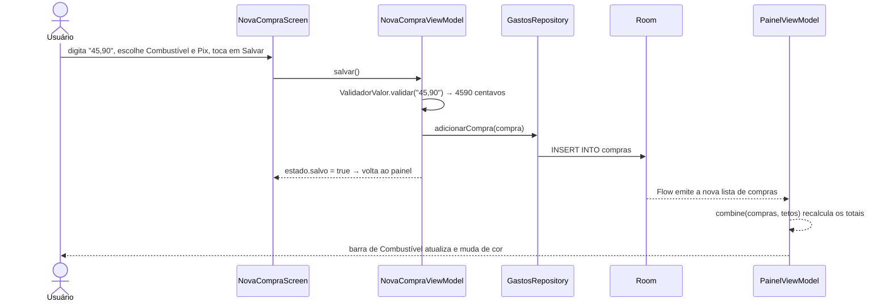
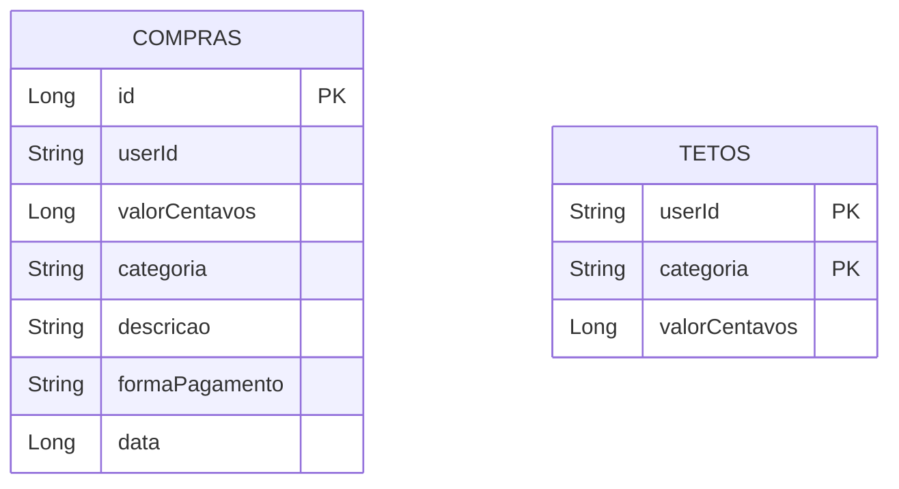

# Controle de Gastos: Despesas Essenciais do Dia a Dia

Aplicativo Android, feito em **Kotlin** e **Jetpack Compose**, para controlar os gastos operacionais do mês nas categorias essenciais: **Supermercado/Feira**, **Combustível/Transporte** e **Farmácia/Saúde** (além de **Outros**).

O usuário define um **teto de gasto mensal para cada categoria**, lança as compras em poucos toques e acompanha, num painel em tempo real, quanto já consumiu de cada teto. As barras mudam de cor conforme o limite se aproxima: **verde → amarelo → vermelho**.

| | |
|---|---|
| **Protótipo no Figma** | [Abrir protótipo](https://www.figma.com/design/Tuhjoh6K7zjuwLU0gIZ6yK/Controle-de-Gastos?node-id=37-118) |
| **Vídeo demonstrativo** | [Assistir no YouTube](https://youtu.be/gWPFr4O_V0E) |

---

## Sumário

1. [Funcionalidades](#1-funcionalidades)
2. [Capturas de tela](#2-capturas-de-tela)
3. [Tecnologias](#3-tecnologias)
4. [Arquitetura MVVM](#4-arquitetura-mvvm)
5. [Estrutura de pastas](#5-estrutura-de-pastas)
6. [Persistência (Room)](#6-persistência-room)
7. [Regras de validação](#7-regras-de-validação)
8. [Regras do alerta de cores](#8-regras-do-alerta-de-cores)
9. [Como executar](#9-como-executar)
10. [Testes](#10-testes)
11. [Autor](#11-autor)

---

## 1. Funcionalidades

| Funcionalidade | Descrição |
|---|---|
| **Autenticação** | Cadastro e login com e-mail e senha pelo **Firebase Authentication**. A sessão fica salva: ao reabrir o app, o usuário já entra no painel. Os erros do Firebase são traduzidos para português (senha fraca, e-mail já cadastrado, credenciais incorretas, sem internet). |
| **Teto por categoria** | Um teto mensal **individual** para cada categoria (ex.: R$ 1.200 Supermercado, R$ 500 Combustível, R$ 250 Farmácia). Deixar o campo vazio significa “sem teto”. O orçamento total é calculado ao vivo enquanto o usuário digita. |
| **Lançamento rápido** | Valor, **categoria obrigatória** (Supermercado, Combustível, Farmácia ou Outros), descrição/estabelecimento (ex.: “Posto Petrobras”, “Drogaria Minas”) e forma de pagamento (Pix, Dinheiro, Cartão de Crédito, Cartão de Débito). Data e hora são registradas automaticamente. |
| **Painel em tempo real** | Uma barra de progresso por categoria com o percentual consumido, quanto falta ou quanto estourou, com alerta de cor. Atualiza sozinha ao lançar ou excluir uma compra. |
| **Resumo global** | Total gasto no mês corrente, orçamento total (soma dos tetos) e **saldo disponível** antes de atingir o limite. Se o orçamento estourar, mostra o valor excedido. |
| **Extrato do mês** | Tela com todas as compras do mês, total e quantidade, filtro por categoria e exclusão após confirmação. O painel mostra as 3 compras mais recentes e um botão "Ver extrato". |
| **Validação e persistência** | Os campos numéricos rejeitam valores negativos, zero, letras e mais de 2 casas decimais. Os dados ficam salvos no **Room Database** e separados por usuário. |

## 2. Capturas de tela

| Login | Cadastro | Painel |
|:---:|:---:|:---:|
|  |  |  |

| Nova compra | Erro de validação | Tetos mensais |
|:---:|:---:|:---:|
|  |  |  |

| Extrato do mês |
|:---:|
|  |

## 3. Tecnologias

| Área | Tecnologia |
|---|---|
| Linguagem | Kotlin |
| Interface | Jetpack Compose + Material 3 |
| Arquitetura | MVVM (Model-View-ViewModel) |
| Estado reativo | `StateFlow` + `collectAsStateWithLifecycle` |
| Navegação | Navigation Compose |
| Autenticação | Firebase Authentication (e-mail/senha) |
| Persistência | Room Database (SQLite) com `Flow` |
| Assíncrono | Kotlin Coroutines |
| Testes | JUnit 4 |
| Requisitos | Android 8.0 (API 26) ou superior |

## 4. Arquitetura MVVM

O app é dividido em três camadas. Cada camada só conversa com a camada vizinha.



### O papel de cada camada

| Camada | Responsabilidade | Neste projeto |
|---|---|---|
| **Model** | Os dados e as regras de acesso a eles. Não sabe que existe uma tela. | Entidades `Compra` e `Teto`, enums `Categoria` e `FormaPagamento`, DAOs do Room, `AuthRepository` (Firebase) e `GastosRepository` (Room). |
| **ViewModel** | Guarda o **estado** da tela, valida as entradas e chama o repositório. Sobrevive à rotação da tela. | Cada ViewModel expõe um `StateFlow<XxxUiState>` com tudo o que a tela precisa desenhar. |
| **View** | Só desenha o estado e repassa os cliques ao ViewModel. Não tem regra de negócio. | Funções `@Composable` que leem o estado com `collectAsStateWithLifecycle()`. |

### Fluxo de dados unidirecional (exemplo: lançar uma compra)



O painel **não precisa ser recarregado**. O `CompraDao` devolve um `Flow`, que emite uma lista nova sempre que a tabela muda. O `PainelViewModel` junta esse fluxo com o dos tetos (`combine`) e publica o resultado num `StateFlow`. O Compose redesenha a tela automaticamente.

### Injeção de dependência

O projeto usa injeção **manual**, sem bibliotecas. A classe `ControleGastosApp` (que estende `Application`) cria o banco e os repositórios **uma única vez**. Cada ViewModel recebe o que precisa pelo construtor:

```kotlin
viewModel { PainelViewModel(app.gastosRepository, uid) }
```

Com isso, os ViewModels não dependem do Android nem do Firebase diretamente e podem ser testados isoladamente.

## 5. Estrutura de pastas

```
app/src/main/java/br/edu/iftm/controlegastos/
├── ControleGastosApp.kt        # Application: cria banco e repositórios
├── MainActivity.kt             # Ponto de entrada; carrega o tema e a navegação
├── data/                       # camada MODEL
│   ├── model/                  # Compra, Teto (entidades) · Categoria, FormaPagamento (enums)
│   ├── local/                  # AppDatabase, CompraDao, TetoDao (Room)
│   └── repository/             # AuthRepository (Firebase), GastosRepository (Room)
├── ui/                         # camadas VIEW e VIEWMODEL
│   ├── auth/                   # AuthViewModel + telas de Login e Cadastro
│   ├── painel/                 # PainelViewModel + PainelScreen
│   ├── compra/                 # NovaCompraViewModel + NovaCompraScreen
│   ├── tetos/                  # TetosViewModel + TetosScreen
│   ├── extrato/                # ExtratoViewModel + ExtratoScreen
│   ├── componentes/            # Peças reutilizáveis: ícones, ItemCompra, diálogo de exclusão
│   ├── navegacao/              # AppNavHost (rotas)
│   └── theme/                  # Cores, tema claro/escuro, cores de alerta
└── util/                       # Regras puras (sem Android), testáveis
    ├── ValidadorValor.kt       # Texto → centavos, com validação
    ├── ValidadorCampos.kt      # E-mail e senha
    ├── Consumo.kt              # Cálculo do nível de alerta (verde/amarelo/vermelho)
    └── Formatador.kt           # R$, datas e mês por extenso
```

### Ícones (SVG)

Os ícones do app são arquivos **SVG**, guardados em [`docs/icones/`](docs/icones). O Android não lê SVG diretamente. Por isso, cada um foi convertido para **Vector Drawable** (o formato vetorial do Android) em `app/src/main/res/drawable/ic_*.xml`. Os dois arquivos usam o mesmo desenho (`pathData`), então o ícone fica nítido em qualquer tamanho de tela.

| Ícone | Uso |
|---|---|
| `supermercado`, `combustivel`, `farmacia`, `outros` | Um por categoria (painel, lista de compras, chips e tetos) |
| `carteira` | Logotipo das telas de login e cadastro |
| `alerta` | Aviso de teto estourado |
| `voltar` | Botão de voltar da barra superior |

Os desenhos vêm do Material Icons, do Google (licença Apache 2.0).

## 6. Persistência (Room)



Decisões tomadas:

- **Valores em centavos (`Long`)**: o `Double` gera erros de arredondamento (`0.1 + 0.2 = 0.30000000000000004`). Guardar R$ 45,90 como `4590` evita esse problema.
- **`userId` em todas as tabelas**: cada conta vê só os próprios dados, mesmo que duas pessoas usem o mesmo aparelho.
- **Chave composta em `tetos` (`userId` + `categoria`)**: cada usuário tem no máximo um teto por categoria. Salvar de novo atualiza o valor (`@Upsert`).
- **Índice em `(userId, data)`**: deixa rápida a busca das compras do mês.
- **Mês corrente**: o repositório calcula o primeiro e o último milissegundo do mês com `YearMonth`. Assim, o painel “zera” sozinho na virada do mês, e o histórico antigo continua salvo.

## 7. Regras de validação

**Valor da compra e tetos** (`ValidadorValor`, coberto por 16 testes):

| Entrada | Resultado |
|---|---|
| `25` · `25,90` · `25.90` · `1.200,50` · `R$ 30,00` | aceito |
| `-10` | recusado: “O valor não pode ser negativo.” |
| `abc` · `12a` · `1,2,3` | recusado: “Digite um número válido.” |
| `0` · `0,00` | recusado: “O valor deve ser maior que zero.” |
| `12,345` | recusado: “Use no máximo 2 casas decimais.” |
| acima de R$ 1.000.000,00 | recusado: “Valor muito alto.” |

A proteção acontece em duas etapas:

1. **Ao digitar**: o campo usa teclado numérico e descarta qualquer caractere que não seja dígito, vírgula ou ponto. Por isso não dá para digitar letras nem o sinal de menos.
2. **Ao salvar**: o `ValidadorValor` confere o formato completo e mostra a mensagem de erro embaixo do campo.

**Outros campos:** a categoria e a forma de pagamento são obrigatórias. A descrição não pode ficar em branco (máx. 60 caracteres). O e-mail precisa ter formato válido. A senha precisa de pelo menos 6 caracteres, e a confirmação precisa ser igual à senha.

## 8. Regras do alerta de cores

| Consumo do teto | Cor | Mensagem |
|---|---|---|
| menos de 75% | Verde | “Restam R$ …” |
| de 75% a 100% | Amarelo | “Atenção: restam R$ …” |
| acima de 100% | Vermelho | “Teto estourado em R$ …” (com ícone de alerta) |
| sem teto definido | Cinza | só mostra o total gasto |

A mesma regra vale para a barra do resumo global (total gasto × soma dos tetos).

## 9. Como executar

### Pré-requisitos
- Android Studio (versão recente) com o Android SDK 37
- Um emulador ou celular com Android 8.0+

### Passo a passo

1. **Clone o repositório**
   ```bash
   git clone https://github.com/gustavognm/ControleGastos.git
   ```
2. **Configure o Firebase** (necessário para o login funcionar):
   1. Acesse o [Console do Firebase](https://console.firebase.google.com/) e crie um projeto.
   2. Clique em **Adicionar app → Android** e informe o pacote `br.edu.iftm.controlegastos`.
   3. Baixe o arquivo **`google-services.json`** e coloque-o na pasta **`app/`**, substituindo o arquivo de exemplo.
   4. No menu **Authentication → Método de login**, ative **E-mail/senha**.
3. **Abra o projeto no Android Studio**, espere o Gradle sincronizar e clique em ▶ **Run**.

> Sem o `google-services.json` verdadeiro o app compila e abre, mas o login e o cadastro mostram erro, porque o arquivo de exemplo não aponta para nenhum projeto real.

## 10. Testes

Os testes de unidade cobrem as regras de negócio que não dependem do Android: validação de valores, validação de e-mail e senha, e o cálculo do nível de alerta.

```bash
./gradlew testDebugUnitTest
```

Resultado: **25 testes, 0 falhas** (`ValidadorValorTest` e `ConsumoTest`).

## 11. Autor

**Gustavo Nunes Melo**, IFTM Campus Patrocínio · Programação para Dispositivos Móveis
